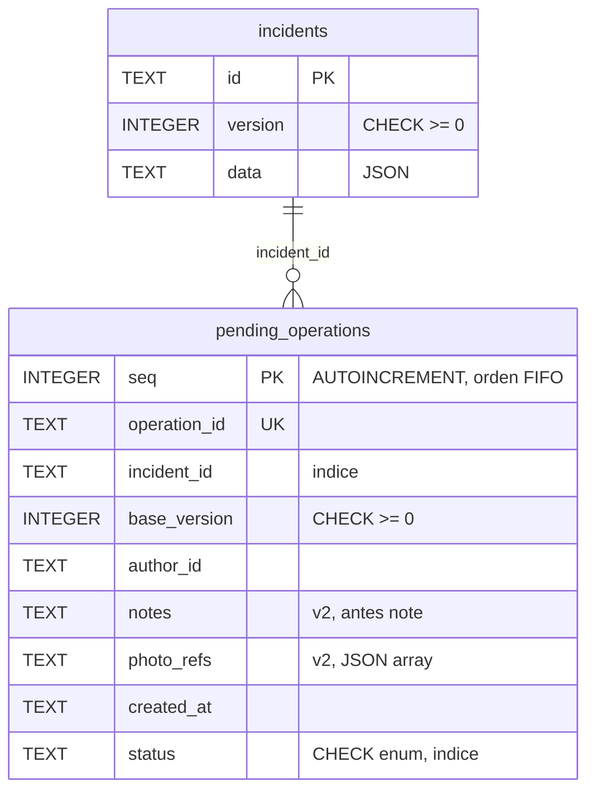
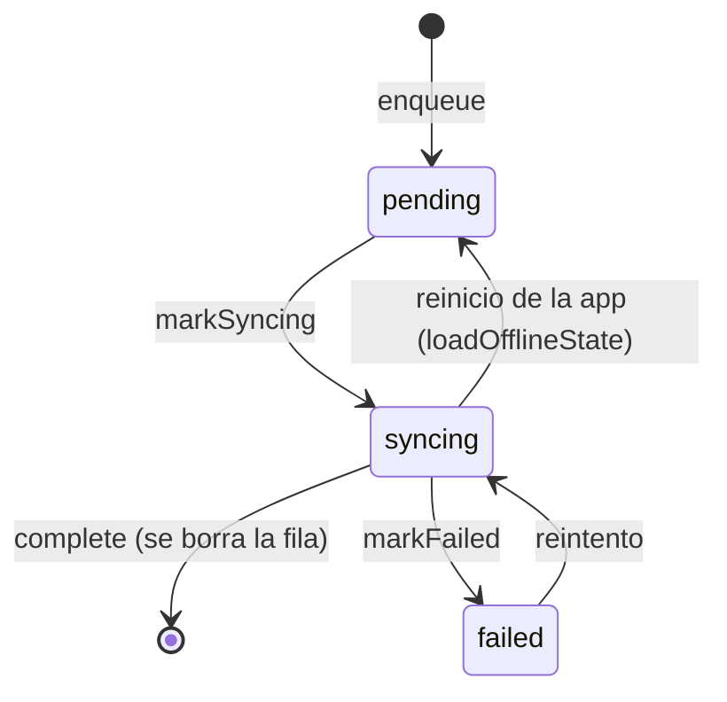

# Modelo de datos local — CampusOps (Semana 08)

Este documento describe cómo la app guarda las incidencias y la cola offline en el dispositivo, cómo evoluciona el esquema y qué garantías ofrece ante reinicios y fallas.

La decisión de usar SQLite y sus alternativas están en [ADR-002](adr/ADR-002-persistence.md).

## 1. Entidades de dominio

### `PendingOperation`: registro pendiente de la cola offline
Definido en `src/domain/offline/types.ts` y validado en `src/domain/offline/validation.ts`.

| Campo | Tipo | Obligatorio | Significado |
|---|---|---|---|
| `operationId` | `string` | Sí, único | Identidad estable de la operación. Sirve como clave de idempotencia al sincronizar. |
| `incidentId` | `string` | Sí | Incidencia afectada. |
| `baseVersion` | `integer >= 0` | Sí | Versión de la incidencia sobre la que se hizo el cambio. Se toma del registro local en la misma transacción del `enqueue` y sirve para detectar conflictos. |
| `authorId` | `string` | Sí | Actor que hizo el cambio sin conexión. |
| `notes` | `string` | Sí (puede ser `''`) | Notas del técnico. |
| `photoRefs` | `string[]` | Sí (puede ser `[]`) | Rutas a copias de las fotos en el almacenamiento privado de la app. No son URIs temporales. |
| `createdAt` | `string` (ISO-8601) | Sí | Momento en que se encoló. |
| `status` | `'pending' \| 'syncing' \| 'failed'` | Sí | Estado del registro (ver §4). |

### `StoredIncident`
Es `Incident` (`src/domain/incidents/types.ts`) más `version: integer >= 0`, que se usa para el control de concurrencia optimista.

## 2. Esquema SQLite

La versión del esquema se guarda en `PRAGMA user_version`. El valor `0` significa una base vacía.

### v1: `initial-schema`
```sql
CREATE TABLE incidents (
  id      TEXT PRIMARY KEY NOT NULL,
  version INTEGER NOT NULL CHECK (version >= 0),
  data    TEXT NOT NULL              -- resto de la incidencia en JSON
);
CREATE TABLE pending_operations (
  seq          INTEGER PRIMARY KEY AUTOINCREMENT,  -- orden FIFO
  operation_id TEXT NOT NULL UNIQUE,
  incident_id  TEXT NOT NULL,
  base_version INTEGER NOT NULL CHECK (base_version >= 0),
  author_id    TEXT NOT NULL,
  note         TEXT NOT NULL DEFAULT '',
  created_at   TEXT NOT NULL,
  status       TEXT NOT NULL CHECK (status IN ('pending','syncing','failed'))
);
```

### v2: `notes-and-photo-refs`
```sql
ALTER TABLE pending_operations RENAME COLUMN note TO notes;
ALTER TABLE pending_operations ADD COLUMN photo_refs TEXT NOT NULL DEFAULT '[]';
CREATE INDEX idx_pending_operations_incident ON pending_operations (incident_id);
CREATE INDEX idx_pending_operations_status   ON pending_operations (status);
```
`RENAME COLUMN` y `ADD COLUMN ... DEFAULT` no reescriben filas, así que todos los registros existentes se conservan. Las operaciones migradas quedan con `photoRefs = []`.


La relación es lógica, no hay `FOREIGN KEY`. Una operación puede seguir existiendo aunque la incidencia se actualice o se reemplace desde el servidor.

## 3. Capas y archivos

| Capa | Archivo | Rol |
|---|---|---|
| domain | `src/domain/offline/types.ts`, `validation.ts` | Tipos y validación sin dependencias. |
| application | `src/application/offline/localStore.ts` | Interfaz `LocalStore` y `LocalStoreTx`. |
| application | `src/application/offline/offlineQueue.ts` | `enqueue`, `markSyncing`, `markFailed`, `complete` y `loadOfflineState`. |
| infrastructure | `src/infrastructure/persistence/sqliteLocalStore.ts` | Implementación sobre SQLite. |
| infrastructure | `expoSqliteDriver.ts` / `nodeSqliteDriver.ts` | Driver de la app / driver de pruebas. |
| infrastructure | `migrations/migrations.ts`, `migrations/runMigrations.ts` | Migraciones y su ejecución. |
| infrastructure | `bootstrap.ts` | Arranque: abrir, migrar y cargar el estado. |
| infrastructure | `fileLocalStore.ts` | Implementación secundaria con archivo JSON atómico. No se usa en la app. |

## 4. Ciclo de vida de una operación


Si la app se cierra con una operación en `syncing`, no se sabe si llegó al servidor. Al reiniciar vuelve a `pending` y se reintenta con el mismo `operationId`, que el servidor trata de forma idempotente.

## 5. Durabilidad y transacciones

- La conexión usa `PRAGMA journal_mode = WAL` y `PRAGMA synchronous = FULL`, así que lo confirmado sobrevive a un cierre abrupto.
- Cada escritura corre dentro de `BEGIN IMMEDIATE … COMMIT`. Ante cualquier error se hace `ROLLBACK` y el error se propaga.
- Hay una sola conexión y todos los accesos van en fila, uno detrás de otro, para que ninguna sentencia se mezcle con una transacción abierta.
- `enqueue` lee la incidencia, valida y escribe dentro de una única transacción.

## 6. Migraciones

- `runMigrations` aplica **todas** las migraciones pendientes en **una sola transacción**, incluido el cambio de `PRAGMA user_version`. En SQLite tanto los cambios de tablas como `user_version` se revierten junto con la transacción.
- Si una migración falla, se lanza `MigrationError` con `fromVersion`, `failedVersion` y `cause`. La base queda exactamente en la versión anterior.
- Si el esquema es más nuevo que el que conoce la app, se niega a degradarlo (`MigrationError`).
- Correr las migraciones dos veces no aplica nada la segunda vez.
- `bootstrapPersistence` siempre migra a la última versión antes de cargar el estado. Si falla, cierra la conexión y lanza el error de nuevo.

**Para agregar una v3:** se añade un nuevo objeto `Migration` con `version: 3` al final de `MIGRATIONS`. Nunca se edita una migración ya publicada. Además se agrega una prueba que parta de una base v2 con datos.

## 7. Recuperación ante fallas

| Escenario | Resultado |
|---|---|
| La app se cierra a mitad de una transacción normal | SQLite descarta lo no confirmado y queda el último estado confirmado. |
| La app se cierra o falla a mitad de una migración | Rollback completo: misma versión, mismo esquema, mismas filas. El siguiente arranque la reintenta. |
| SQL inválido dentro de una migración | Se revierten también los cambios de tablas que ya se habían ejecutado. |
| `operationId` repetido | `DuplicateOperationError` y nada se escribe. |
| Operación en `syncing` al reiniciar | Vuelve a `pending`. |

## 8. Datos sensibles

Es una excepción aprobada en ADR-002 a `docs/security-controls.md`:
- **Minimización:** solo se guardan los campos de §1. Los tokens y credenciales **no** van aquí; siguen en `expo-secure-store`.
- **Expiración:** `complete(operationId)` borra la fila al confirmarse la sincronización, y la foto asociada se borra del almacenamiento privado.
- **Fotos:** se copian a `documentDirectory` antes de encolarlas, y `photoRefs` guarda esa ruta, no la URI temporal del selector.
- **Pruebas:** solo usan datos ficticios (`fake-inc-001`, `tech-demo-01`, `file:///app-private/photos/fake-0001.jpg`).

## 9. Verificación

Comando:
```powershell
npm run evidence:week08
```
El comando corre `course-tests/week-08-persistence.test.ts` sobre SQLite real en archivos temporales y escribe [`reports/week-08/migration-tests.json`](../reports/week-08/migration-tests.json) con el comando, el resultado observado de cada prueba y el SHA. Exige que no haya cambios sin commit fuera de `reports/` y `evidence/`.

| id | Tipo | Qué demuestra |
|---|---|---|
| `queue-survives-restart` | nominal | La cola conserva identidad, versión base, autor, notas, fotos y orden tras reabrir. |
| `syncing-recovers-after-restart` | boundary | Una operación interrumpida vuelve a `pending`. |
| `duplicate-operation-no-partial-state` | failure | Un `operationId` repetido no deja cambios a medias. |
| `migration-v1-to-v2-preserves-data` | nominal | La migración v1 → v2 conserva todas las filas. |
| `migration-idempotent` | boundary | Migrar dos veces no hace nada la segunda vez. |
| `migration-refuses-downgrade` | boundary | Un esquema más nuevo no se modifica. |
| `migration-injected-failure-rollback` | failure | Una falla antes del COMMIT deja la base idéntica; el reintento posterior migra sin perder datos. |
| `migration-broken-sql-rollback` | failure | Los cambios de tablas parciales se revierten. |

## 10. Limitaciones conocidas

- La persistencia todavía no está conectada en `App.tsx`. Falta pasarle `createExpoSqliteDriver` y un generador de UUID cuando la interfaz use la cola.
- La copia y subida de fotos al servidor no está implementada en esta entrega. `photoRefs` solo guarda las rutas.
- El driver de expo-sqlite no se ejercita en Jest porque es un módulo nativo. Comparte el mismo SQL que el driver de Node, pero su comportamiento en un dispositivo debe validarse en un build Android.
- `node:sqlite` figura como experimental en Node 22. Si cambia su API, la alternativa es `better-sqlite3` (ver ADR-002).
